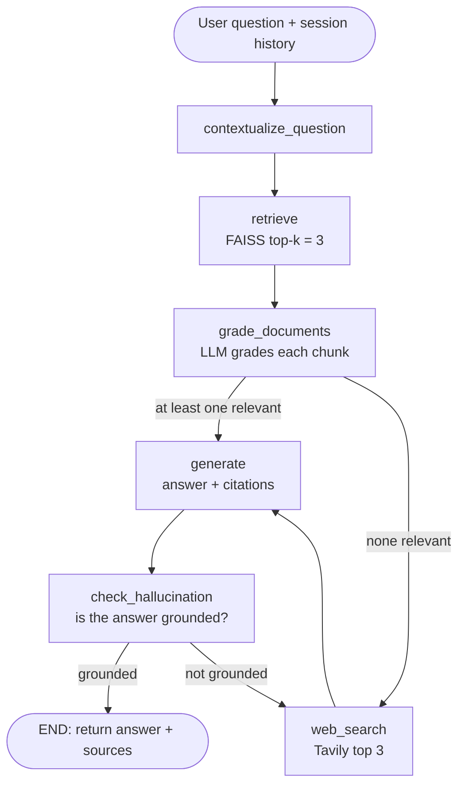

# Technical Documentation RAG Assistant

A Retrieval-Augmented Generation (RAG) assistant that answers questions about technical documentation. It is built as a **LangGraph `StateGraph`** with retrieval, LLM-based document grading, web-search fallback, answer generation with source citations, and a hallucination check. It is served through **FastAPI**, with a **Streamlit** chat UI on top.

Built as the take-home assignment for the **Express Analytics – AI/ML Engineer Intern** role.

---

## Table of Contents

1. [Features](#features)
2. [Tech Stack](#tech-stack)
3. [Architecture](#architecture)
4. [Project Structure](#project-structure)
5. [Setup](#setup)
6. [Running the Application](#running-the-application)
7. [API Reference & Examples](#api-reference--examples)
8. [Ingestion, Chunking & Embedding Strategy](#ingestion-chunking--embedding-strategy)
9. [Design Decisions & Tradeoffs](#design-decisions--tradeoffs)
10. [Assumptions](#assumptions)
11. [Known Limitations](#known-limitations)
12. [What I Would Improve With More Time](#what-i-would-improve-with-more-time)

---

## Features

**Core requirements**

- LangGraph workflow with retrieval, document grading, conditional routing and generation nodes
- LLM-based relevance grading of every retrieved chunk (`yes` / `no`), with irrelevant chunks filtered out
- Conditional edges that route on grading outcome
- Answers with source citations
- Ingestion pipeline: load, chunk, embed, store in FAISS
- FastAPI endpoints: `/query`, `/ingest`, `/documents`, `/feedback`

**Bonus features implemented**

- **Hallucination check**: a node that verifies the generated answer is grounded in the retrieved context (inspired by Self-RAG)
- **Web search fallback**: Tavily search when the vector store has no relevant results
- **Conversation memory**: per-session chat history, plus a node that rewrites follow-up questions into standalone questions
- **Simple UI**: Streamlit frontend for upload, listing documents and chatting

---

## Tech Stack

| Layer | Choice |
|---|---|
| Orchestration | LangGraph (`StateGraph`) |
| LLM | Groq, `openai/gpt-oss-120b` via `langchain-groq` (temperature 0) |
| Embeddings | HuggingFace `all-MiniLM-L6-v2` (runs locally, no API key) |
| Vector store | FAISS (`IndexFlatL2`), persisted to `database/` |
| Web search | Tavily |
| API | FastAPI + Uvicorn |
| UI | Streamlit |
| Validation | Pydantic |

---

## Architecture

### Workflow



### Nodes

| Node | What it does |
|---|---|
| `contextualize_question` | If the session has chat history, the LLM rewrites the latest question into a standalone question (it resolves references like "what about its parameters?"). With no history, the question passes through unchanged. |
| `retrieve` | Runs similarity search against the FAISS index and returns the top 3 chunks with their source metadata. |
| `grade_documents` | The LLM, using structured output (`binary_score: yes/no`), grades each retrieved chunk against the question. Irrelevant chunks are dropped. If none survive, `web_search_needed` is set to `True`. |
| `web_search` | Calls Tavily (up to 3 results), merges the content into one `Document` with source `"Tavily Web Search"`, and appends it to the surviving documents. |
| `generate` | The LLM answers concisely using the graded context and chat history. It is instructed to say it doesn't know when the context is insufficient, and to cite its sources. |
| `check_hallucination` | The LLM grades whether the answer is strictly supported by the context. If not, the graph routes to `web_search` for more evidence and regenerates. |

### Conditional edges

1. **After `grade_documents`**: `web_search_needed == True` goes to `web_search`; otherwise it goes to `generate`.
2. **After `check_hallucination`**: `is_grounded == True` goes to `END`; otherwise it goes back to `web_search`.

### State schema

```python
class GraphState(TypedDict):
    question: str             # raw, then standalone (rewritten) question
    chat_history: List[dict]  # [{"role": "user"|"assistant", "content": "..."}]
    documents: List[Document] # retrieved, then graded, then web-augmented chunks
    answer: str               # generated answer
    web_search_needed: bool   # set by grade_documents, read by the router
    is_grounded: bool         # set by check_hallucination, read by the router
```

---

## Project Structure

```
internship_project/
├── main.py            # FastAPI app: /query, /ingest, /documents, /feedback
├── graph.py           # LangGraph state, nodes, edges, compiled workflow
├── ingestion.py       # Document loading, chunking, indexing, listing sources
├── database.py        # FAISS vector store: load, save, retriever
├── models.py          # Pydantic request/response schemas
├── app.py             # Streamlit frontend
├── requirements.txt
├── data/              # Document corpus (and files uploaded via /ingest)
├── database/          # Persisted FAISS index (index.faiss / index.pkl)
└── .gitignore
```

---

## Setup

### Prerequisites

- Python 3.10+
- A [Groq API key](https://console.groq.com/) (free tier available)
- A [Tavily API key](https://tavily.com/) (free tier: 1,000 searches/month)

### 1. Clone the repository

```bash
git clone https://github.com/sahilkumarkesarwani/internship_project.git
cd internship_project
```

### 2. Create a virtual environment

```bash
python -m venv venv
source venv/bin/activate        # Windows: venv\Scripts\activate
```

### 3. Install dependencies

```bash
pip install -r requirements.txt
pip install fastapi streamlit requests pypdf sentence-transformers
```

> `fastapi`, `streamlit`, `requests`, `pypdf` and `sentence-transformers` are imported by the code but are not listed in `requirements.txt` yet. Add them there so a single `pip install -r requirements.txt` works.

### 4. Configure environment variables

Create a `.env` file in the project root:

```env
GROQ_API_KEY=your_groq_api_key
TAVILY_API_KEY=your_tavily_api_key
```

---

## Running the Application

**Start the FastAPI backend**

```bash
uvicorn main:app --reload
```

- API: http://127.0.0.1:8000
- Interactive docs (Swagger): http://127.0.0.1:8000/docs

**Start the Streamlit UI** (in a second terminal)

```bash
streamlit run app.py
```

The UI expects the backend at `http://127.0.0.1:8000`.

**First-time use:** the index starts empty. Ingest your documents first, either from the Streamlit sidebar or with `POST /ingest` (see below).

---

## API Reference & Examples

| Method | Endpoint | Purpose |
|---|---|---|
| `POST` | `/query` | Ask a question; returns answer plus sources |
| `POST` | `/ingest` | Upload and index a document |
| `GET` | `/documents` | List indexed document sources |
| `POST` | `/feedback` | Submit thumbs up/down feedback with an optional comment |

### `POST /query`

**Request**

```bash
curl -X POST http://127.0.0.1:8000/query \
  -H "Content-Type: application/json" \
  -d '{"question": "How do I define a request body in FastAPI?", "session_id": "demo"}'
```

| Field | Type | Notes |
|---|---|---|
| `question` | string | Required |
| `session_id` | string | Optional, defaults to `"default"`. Requests with the same ID share chat history. |

**Response** (shape; the text is illustrative)

```json
{
  "question": "How do I define a request body in FastAPI?",
  "answer": "You declare a Pydantic model and use it as a parameter type in your path operation function... Source: data/fastapi_body.md",
  "sources": ["data/fastapi_body.md"]
}
```

- `question` is the standalone version after follow-up rewriting.
- `sources` is the de-duplicated list of source files/URLs behind the answer. It contains `"Tavily Web Search"` if the web fallback was used.

**Follow-up example** (same `session_id`)

```bash
curl -X POST http://127.0.0.1:8000/query \
  -H "Content-Type: application/json" \
  -d '{"question": "Can it be optional?", "session_id": "demo"}'
```

### `POST /ingest`

Upload a document as multipart form data. Supported types: `.md`, `.txt`, `.pdf`.

```bash
curl -X POST http://127.0.0.1:8000/ingest \
  -F "file=@./data/fastapi_body.md"
```

```json
{ "message": "Successfully uploaded and ingested fastapi_body.md" }
```

Returns `500` if the document cannot be processed.

### `GET /documents`

```bash
curl http://127.0.0.1:8000/documents
```

```json
{ "indexed_documents": ["data/fastapi_body.md", "data/pydantic_models.md"] }
```

### `POST /feedback`

```bash
curl -X POST http://127.0.0.1:8000/feedback \
  -H "Content-Type: application/json" \
  -d '{"question_id": "demo-1", "feedback": "thumbs_up", "comment": "Clear answer"}'
```

```json
{ "message": "Feedback recorded" }
```

| Field | Type | Notes |
|---|---|---|
| `question_id` | string | Required |
| `feedback` | string | e.g. `thumbs_up` / `thumbs_down` |
| `comment` | string | Optional |

---

## Ingestion, Chunking & Embedding Strategy

**Pipeline:** load file, split into chunks, embed, add to FAISS, save to disk (`database/`).

| Step | Choice | Why |
|---|---|---|
| Loading | `TextLoader` for `.md`/`.txt`, `PyPDFLoader` for `.pdf` | Covers the common documentation formats with minimal code. |
| Chunking | `RecursiveCharacterTextSplitter`, **1000 chars, 200 overlap** | The recursive splitter tries paragraph, then line, then sentence, then word boundaries, so it tends to keep related text together. 1000 characters is large enough to hold a code snippet plus its explanation, and small enough that embeddings stay focused. The 200-character overlap (20%) reduces the chance that an answer is split across a chunk boundary. |
| Embeddings | `all-MiniLM-L6-v2` (384-dim) | Free, fast, runs on CPU, and needs no API key, which keeps the project cheap and easy to reproduce. |
| Vector store | FAISS `IndexFlatL2` | Exact search is more than fast enough for a small corpus, with no server to run. The index persists to disk and reloads on startup. |
| Retrieval | Top **k = 3** | Keeps the prompt small and the grading cost low (one LLM call per retrieved chunk). |

**Corpus:** documents live in `data/`.
<!-- TODO: list the exact corpus, e.g. "FastAPI: request body, dependencies; Pydantic: models; ..." with source URLs, and the script/command used to fetch them. -->

---

## Design Decisions & Tradeoffs

**Why a self-corrective graph instead of a linear chain?**
Plain RAG always answers with whatever it retrieves, even when retrieval was poor. Grading each chunk before generation, and checking the answer afterwards, adds two checkpoints where the system can notice it is about to give a bad answer.

**Web search as the fallback path.**
When grading rejects every chunk, the graph falls back to Tavily web search instead of answering from nothing. The assignment suggested rewrite-and-re-retrieve with a retry limit; this implementation uses the web-search fallback from the bonus section instead. The tradeoff is that answers can then come from outside the curated corpus, which is why the source is labelled `"Tavily Web Search"` in the response.

**LLM grading, one call per chunk.**
Using an LLM with structured output (`yes`/`no`) judges relevance better than a similarity threshold. The cost is extra latency and tokens, which is why `k` is kept at 3.

**Temperature 0 everywhere.**
Grading and generation should be deterministic and repeatable.

**Groq for the LLM.**
Fast inference and a free tier, which makes the multi-call workflow (rewrite, N gradings, generate, hallucination check) feel responsive.

**Local embeddings.**
No per-token cost and no external dependency for indexing. The tradeoff is lower retrieval quality than larger hosted embedding models.

**In-memory chat sessions, capped at 6 messages.**
Simple and enough for follow-up questions. The cap keeps the prompt short. Sessions are lost on restart.

**Separate FastAPI backend and Streamlit frontend.**
The API is the product; the UI is a thin client over it, so either can be swapped independently.

---

## Assumptions

- Documents are English technical text in Markdown, plain text or PDF.
- The corpus is small enough for exact (flat) vector search.
- A single user or low concurrency; there is no authentication.
- Groq and Tavily API keys are available to whoever runs the project.

---

## Known Limitations

Documented honestly so reviewers can see where the current implementation differs from the assignment brief:

1. **No dedicated query-analysis node.** The first node only rewrites follow-ups using chat history. It does not expand queries with synonyms or classify the query type (conceptual / how-to / troubleshooting / API reference).
2. **No re-retrieval retry loop and no retry counter in state.** On failed grading the graph goes to web search rather than rewriting the query and retrieving again.
3. **The hallucination loop is unbounded.** `check_hallucination` routes back to `web_search` when the answer is not grounded, with no retry limit. LangGraph's default recursion limit would eventually stop it with an error, but it should be capped explicitly (for example with a `retries` field in state).
4. **`/ingest` accepts file uploads only**, not URLs.
5. **`/documents` reads FAISS's internal docstore**, which is an implementation detail. It lists source paths, not clean document titles.
6. **Feedback is only printed to the console**, not persisted. The `/feedback` handler also looks up `request_id`, but the schema field is `question_id`, so the ID is never printed.
7. **Chat sessions are in memory** and reset when the server restarts.
8. **Re-uploading the same file adds duplicate chunks** to the index; there is no de-duplication.
9. **No automated tests or evaluation set.**
10. **`requirements.txt` is incomplete** (see Setup) and unpinned.

---

## What I Would Improve With More Time

- Add a proper **query-analysis node**: query expansion and classification, with the class used to adjust retrieval (for example larger `k` for troubleshooting questions).
- Add **`retries` to the graph state** and a bounded **rewrite → re-retrieve** loop before falling back to web search; cap the hallucination loop the same way.
- **Chunk by document structure** (Markdown headers, code blocks kept intact) and store the section title in metadata for more precise citations.
- **Hybrid retrieval** (BM25 + vectors) and a **reranker**, since technical docs contain many exact identifiers that pure embeddings can miss.
- **Grade chunks in parallel** or in a single batched call to cut latency.
- **Ingest from URLs**, de-duplicate on re-ingest, and track documents in a small metadata table so `/documents` and deletion are clean.
- **Persist feedback** (SQLite) and use it to flag weak answers.
- **Persist sessions** (Redis or SQLite).
- **Return richer metadata** from `/query`: whether web fallback was used, grounded flag, and per-source chunk previews.
- Add **tests** (`pytest` for the API, graph routing with a mocked LLM) and an **evaluation set** of question/answer pairs to measure retrieval and answer quality.
- **Dockerize** the project and pin dependency versions.

---

## Author

**Sahil Kumar Kesarwani**
GitHub: [@sahilkumarkesarwani](https://github.com/sahilkumarkesarwani)