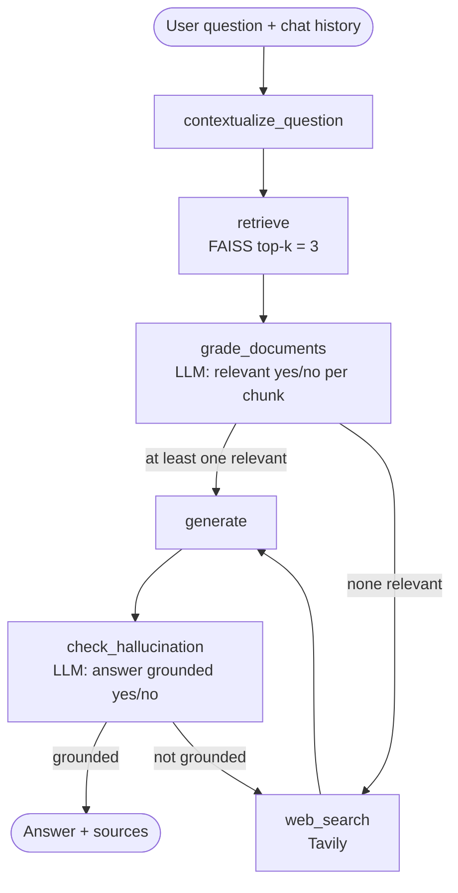

# Technical Documentation RAG Assistant

A Retrieval-Augmented Generation (RAG) assistant that answers questions about a set of technical documents. It is built as a **LangGraph `StateGraph`** with query contextualization, retrieval, LLM-based document grading, web-search fallback, answer generation with sources, and a hallucination check. It is served through **FastAPI** and has a small **Streamlit** chat UI.

Built for the Express Analytics AI/ML Engineer Intern take-home assignment.

---

## Table of Contents

1. [Project Overview](#project-overview)
2. [Features](#features)
3. [Tech Stack](#tech-stack)
4. [Project Structure](#project-structure)
5. [Architecture](#architecture)
6. [Setup](#setup)
7. [Running the Application](#running-the-application)
8. [API Reference and Examples](#api-reference-and-examples)
9. [Ingestion, Chunking and Embedding Strategy](#ingestion-chunking-and-embedding-strategy)
10. [Design Decisions and Tradeoffs](#design-decisions-and-tradeoffs)
11. [Assumptions](#assumptions)
12. [Known Limitations and What I Would Improve](#known-limitations-and-what-i-would-improve)

---

## Project Overview

**The problem.** Technical documentation is long, and keyword search often misses the exact passage a developer needs. A plain LLM, on the other hand, may answer confidently from memory and get details wrong.

**The solution.** This project is a Retrieval-Augmented Generation (RAG) system that answers questions *from your own documents*. When a user asks a question, the system:

1. rewrites follow-up questions into standalone questions using the chat history,
2. retrieves the most similar chunks from a FAISS vector index,
3. uses an LLM to **grade each chunk for relevance** and discard the irrelevant ones (the self-corrective step),
4. falls back to a web search if no local chunk is relevant,
5. generates an answer that cites its sources, and
6. checks that the answer is actually supported by the context before returning it.

The whole flow is a LangGraph state machine, exposed through a FastAPI service (`/query`, `/ingest`, `/documents`, `/feedback`) and a Streamlit chat interface.

**Who it is for.** Developers or support teams who want question answering over a fixed set of technical docs (library docs, README files, API references) with sources they can verify.

---

## Features

| Area | Status |
|---|---|
| LangGraph workflow (query analysis, retrieval, grading, generation) | Implemented |
| Conditional routing based on grading outcome | Implemented |
| FAISS vector store with local embeddings | Implemented |
| Document ingestion (`.txt`, `.md`, `.pdf`) via file upload | Implemented |
| FastAPI endpoints: `/query`, `/ingest`, `/documents`, `/feedback` | Implemented |
| **Bonus:** hallucination check (Self-RAG style) | Implemented |
| **Bonus:** web search fallback (Tavily) | Implemented |
| **Bonus:** conversation memory (per `session_id`) | Implemented |
| **Bonus:** Streamlit UI | Implemented |
| Query rewrite + re-retrieve with retry limit | Not yet (see [limitations](#known-limitations-and-what-i-would-improve)) |
| Ingestion from URLs | Not yet |

## Tech Stack

- **Orchestration:** LangGraph, LangChain
- **LLM:** Groq (`openai/gpt-oss-120b`), temperature 0
- **Embeddings:** `sentence-transformers/all-MiniLM-L6-v2` (HuggingFace, runs locally, no API key)
- **Vector store:** FAISS (`IndexFlatL2`), persisted to `database/`
- **Web search:** Tavily
- **API:** FastAPI + Uvicorn
- **UI:** Streamlit

## Project Structure

```
internship_project/
├── main.py           # FastAPI application (API endpoints)
├── app.py            # Streamlit chat UI (talks to the FastAPI backend)
├── graph.py          # LangGraph workflow: state, nodes, routing
├── ingestion.py      # Load -> split -> embed -> store; list indexed documents
├── database.py       # FAISS vector store creation, loading, saving, retriever
├── models.py         # Pydantic request/response schemas
├── requirements.txt
├── data/             # Document corpus (and files uploaded via /ingest)
└── database/         # Persisted FAISS index (index.faiss / index.pkl)
```

> Note: `main.py` is the **FastAPI backend**, and `app.py` is the **Streamlit frontend**.

## Architecture

### Workflow



### Graph state

```python
class GraphState(TypedDict):
    question: str            # current (standalone) question
    chat_history: List[dict] # prior turns for this session
    documents: List[Document]# retrieved / filtered / web documents
    answer: str              # generated answer
    web_search_needed: bool  # set by the grader, read by the router
    is_grounded: bool        # set by the hallucination checker
```

### Nodes

1. **`contextualize_question` (query analysis).** If the session has chat history, the LLM rewrites the latest question into a standalone question (resolving pronouns such as "it" or "that function"). With no history, the question passes through unchanged.
2. **`retrieve`.** Runs similarity search on the FAISS index and returns the top 3 chunks with their source metadata.
3. **`grade_documents` (self-corrective step).** The LLM grades every retrieved chunk against the question using structured output (`yes` / `no`). Irrelevant chunks are dropped. If nothing survives, `web_search_needed` is set.
4. **`web_search`.** Fallback to Tavily (top 3 results). The results are appended as a single document with source `Tavily Web Search`.
5. **`generate`.** The LLM answers using the filtered context and chat history, and cites the sources at the end of the answer.
6. **`check_hallucination`.** The LLM checks whether the answer is fully supported by the context. If not, the graph routes back to `web_search`.

### Routing logic (conditional edges)

| After node | Condition | Next |
|---|---|---|
| `grade_documents` | `web_search_needed == True` | `web_search` |
| `grade_documents` | otherwise | `generate` |
| `check_hallucination` | `is_grounded == True` | `END` |
| `check_hallucination` | `is_grounded == False` | `web_search` |

## Setup

### Prerequisites

- Python 3.10 or newer
- A [Groq API key](https://console.groq.com/) (free tier available)
- A [Tavily API key](https://tavily.com/) (free tier: 1,000 searches/month)

### Installation

```bash
git clone https://github.com/sahilkumarkesarwani/internship_project.git
cd internship_project

python -m venv venv
source venv/bin/activate        # Windows: venv\Scripts\activate

pip install -r requirements.txt
```

### Environment variables

Create a `.env` file in the project root:

```env
GROQ_API_KEY=your_groq_api_key
TAVILY_API_KEY=your_tavily_api_key
```

`.env` is loaded automatically with `python-dotenv`. Never commit it.

## Running the Application

**1. Start the FastAPI backend**

```bash
uvicorn main:app --reload
```

The API is now at `http://127.0.0.1:8000`, with interactive docs at `http://127.0.0.1:8000/docs`.

**2. (Optional) Start the Streamlit UI** in a second terminal

```bash
streamlit run app.py
```

Open `http://localhost:8501`. The UI lets you upload files, list indexed documents, and chat with the assistant. Use the same *Session ID* to keep follow-up context.

**3. Ingest the corpus**

Upload the documents in `data/` through the UI or the `/ingest` endpoint (examples below). The FAISS index is saved to `database/` and reused on the next start.

## API Reference and Examples

> The response bodies below show the response structure; the answer text is illustrative.

### `POST /query` - ask a question

```bash
curl -X POST http://127.0.0.1:8000/query \
  -H "Content-Type: application/json" \
  -d '{"question": "How do I define a path parameter in FastAPI?", "session_id": "demo"}'
```

```json
{
  "question": "How do I define a path parameter in FastAPI?",
  "answer": "Declare it in the path using curly braces and add a matching function argument, e.g. `@app.get(\"/items/{item_id}\")`. ... Source: data/fastapi_path_params.md",
  "sources": ["data/fastapi_path_params.md"]
}
```

Send a follow-up with the same `session_id` (e.g. `"What if I want it to be an integer?"`) and the question is rewritten into a standalone question using the chat history. The last 6 messages are kept per session.

### `POST /ingest` - upload a document

```bash
curl -X POST http://127.0.0.1:8000/ingest \
  -F "file=@data/fastapi_path_params.md"
```

```json
{ "message": "Successfully uploaded and ingested fastapi_path_params.md" }
```

### `GET /documents` - list indexed sources

```bash
curl http://127.0.0.1:8000/documents
```

```json
{ "indexed_documents": ["data/fastapi_path_params.md", "data/pydantic_models.md"] }
```

### `POST /feedback` - rate an answer

```bash
curl -X POST http://127.0.0.1:8000/feedback \
  -H "Content-Type: application/json" \
  -d '{"question_id": "demo-1", "feedback": "thumbs_up", "comment": "Clear answer"}'
```

```json
{ "message": "Feedback recorded" }
```

## Ingestion, Chunking and Embedding Strategy

**Pipeline:** load file (`TextLoader` for `.txt`/`.md`, `PyPDFLoader` for `.pdf`) -> split -> embed -> add to FAISS -> save to disk.

**Chunking:** `RecursiveCharacterTextSplitter` with `chunk_size=1000` characters and `chunk_overlap=200` (20%).

Why these choices:

- **Recursive splitting** tries paragraph breaks first, then lines, then sentences, then words. This keeps related text together better than fixed-size splitting, which matters for technical prose.
- **1000 characters is roughly 200-250 tokens**, which fits inside the 256-token input window of `all-MiniLM-L6-v2`. Larger chunks would be silently truncated by the embedding model.
- **200 characters of overlap** reduces the chance that an explanation and the code example that follows it are separated across two chunks.

**Embeddings:** `all-MiniLM-L6-v2` is small (384 dimensions), fast on CPU, free, and requires no API key, so the project is easy for a reviewer to run.

**Retrieval:** top-k = 3 by L2 distance on a flat FAISS index (exact search; fine at this corpus size).

## Design Decisions and Tradeoffs

| Decision | Why | Tradeoff |
|---|---|---|
| **LLM grading of every chunk** | Vector similarity can return text that is topically close but does not answer the question. The grader filters it before generation. | One extra LLM call per chunk (latency and cost); results depend on the grader prompt. |
| **Web search instead of "I don't know" when nothing is relevant** | Gives the user an answer when the local corpus has a gap. | The answer may no longer be grounded in the provided docs; web results are merged into one source entry. |
| **Hallucination check after generation** | Catches answers that are not supported by the context. | One more LLM call per query; a failed check currently routes to web search rather than a bounded retry. |
| **Conversation memory in a Python dict** | Simple, no extra infrastructure. Enables follow-up questions. | Lost on restart; not shared across workers; unbounded number of sessions. |
| **FAISS with local embeddings** | Zero external dependencies for retrieval; reproducible. | No metadata filtering, no built-in deletion, and the index is a local file. |
| **Groq-hosted open model** | Very fast inference and a generous free tier. | Rate limits on the free tier; structured-output behaviour can differ across models. |
| **Streamlit separate from FastAPI** | Keeps the API clean and the UI optional. | Two processes to run. |

## Assumptions

- The corpus is a small set of technical documents (Markdown, text, or PDF) stored locally in `data/`.
- Questions are in English.
- The service runs as a single process, so in-memory sessions are acceptable for a demo.
- The caller supplies the `session_id`; there is no authentication.
- Files uploaded through `/ingest` come from a trusted user.

## Known Limitations and What I Would Improve

I would rather be upfront about the gaps than hide them:

1. **No query-rewrite and retry loop.** The assignment asks for "rewrite query and re-retrieve (with a retry limit)" when no relevant documents are found. Currently the graph goes straight to web search. My next step is to add `retry_count` to the state and a `rewrite_query` node that loops back to `retrieve`, falling back to web search or "I don't know" after N attempts.
2. **No retry cap on the hallucination loop.** If the answer is repeatedly judged ungrounded, the graph cycles between `web_search`, `generate`, and `check_hallucination` until LangGraph's recursion limit raises an error. This needs a counter and a final "I don't know" response.
3. **Query analysis is contextualization only.** There is no query expansion or query-type classification (conceptual, how-to, troubleshooting, API reference).
4. **Generic chunking.** A Markdown-aware splitter (split by headers, keep code blocks intact, store the section title as metadata) would improve retrieval and make citations point to specific sections.
5. **Citations are file-level.** Sources are file paths. Chunk-level citations (file + section or page) would be more useful.
6. **Ingestion from URLs** is not supported yet, and re-uploading the same file creates duplicate chunks.
7. **Performance.** The FAISS index is reloaded from disk on every query, and chunk grading runs sequentially. Caching the vector store and using `.batch()` for grading would reduce latency. FastAPI endpoints are `async` but call blocking code; they should use `ainvoke` or run in a thread pool.
8. **Feedback is only printed to the console.** It should be persisted (SQLite or a file) and validated (`thumbs_up` / `thumbs_down`).
9. **Input validation and security.** Uploaded filenames should be sanitized, file types validated, and exceptions from the graph converted into meaningful HTTP errors.
10. **Evaluation and tests.** A small question set with expected sources, plus metrics such as retrieval hit rate and groundedness, would show whether changes actually help.